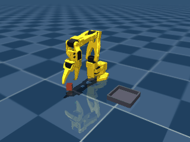

# so101-pick

The SO-101 arm picks up a cube and drops it in a tray, in MuJoCo. The cube
spawns at a random spot and angle each run.



The inverse kinematics is hand-written in C (`ik.c`). With the gripper
pointing straight down, the arm after the base joint is just a flat 2-link
arm plus the wrist, so it's the law of cosines. Python calls it through
ctypes. `pick.py` moves the tip through a list of waypoints (above the cube,
down, close, up, over the tray, open) and calls the IK every step.

This builds on my [so101-sim](https://github.com/mike200004/so101-sim) repo
(the arm model and meshes are copied from there).

## Run

```bash
make                      # builds libik.so
pip install -r requirements.txt

python pick.py            # opens the viewer
python pick.py 100        # 100 random cubes, no window
pytest
```

## Things I ran into

- The SO-101 gripper has one fixed jaw and one moving jaw, and the fixed one
  is off to the side of the wrist. Aiming straight at the cube put the fixed
  jaw on top of it, so the plan aims 8 mm behind the cube.
- The cube kept squirting out of the jaws until I set `cone="elliptic"` and
  `impratio="10"` in `scene.xml`. After that it went from 0/100 to 100/100.
- With the gripper pointing down the wrist joint hits its limit if the tip
  goes above ~8 cm, so everything moves at 6 cm height.
- The numbers at the top of `ik.c` come from `measure.py`.

## Files

| File | |
| --- | --- |
| `ik.c` | IK solver |
| `ik.py` | loads `libik.so` with ctypes |
| `pick.py` | the pick-and-place script |
| `scene.xml` | floor, cube, tray, actuators |
| `so101.xml`, `meshes/` | the arm, from so101-sim |
| `measure.py` | measures the link lengths used in `ik.c` |
| `record_gif.py` | makes `demo.gif` |

## License

Apache-2.0. Meshes are from TheRobotStudio/SO-ARM100 (Apache-2.0), see
`meshes/NOTICE.md`.
